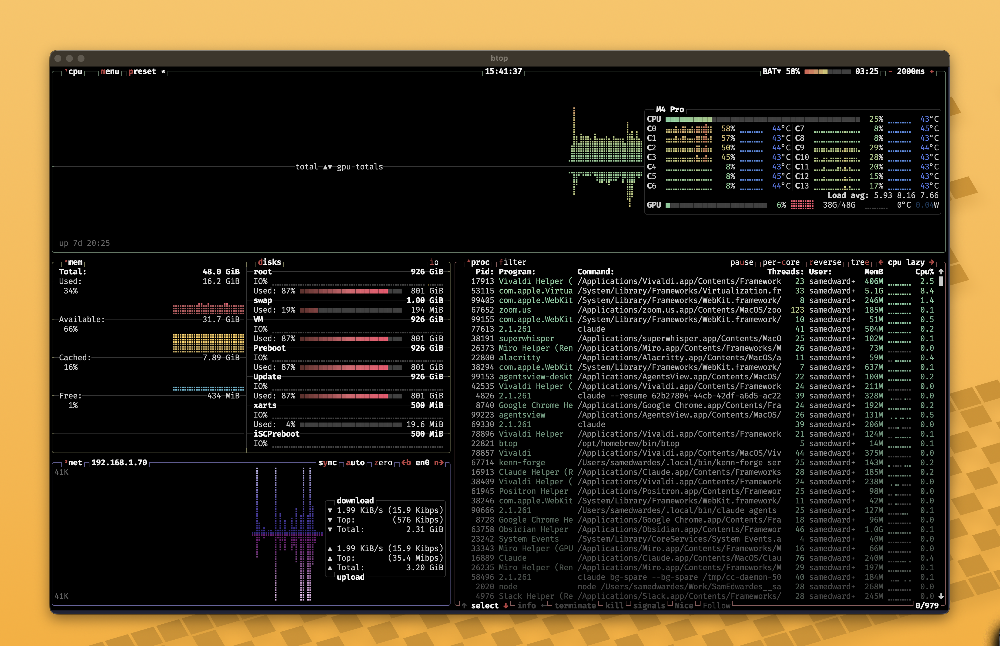
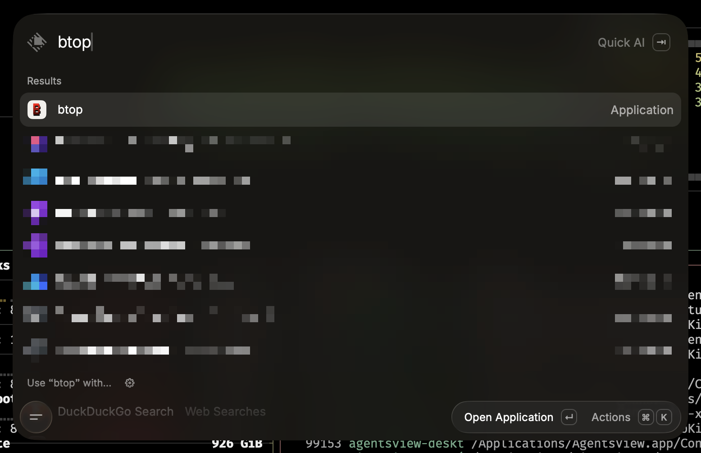

import Callout from "../../../components/Callout.astro";

## Omarchy TUIs

I started playing around with [Omarchy](https://omarchy.org/) a little bit and I really like it. I love the tiling window manager, I like the aesthetic, and I like the customizations.

One Omarchy concept that I was introduced to was treating TUIs like normal desktop apps. In Omarchy you can open LazyDocker or Claude Code or btop in such a way that it feels like a standalone desktop app. It launches in its own window, you can launch it from your keyboard (via keyboard shortcuts or a launcher), and you're able to manage it like any other program (e.g. `cmd + tab` to it).

## TUIs on a Mac

While I like using Omarchy, I still use a Mac for work and I wanted similar functionality. Using Alacritty, I was able to create a similar pattern to what Omarchy does.

Let's take btop as an example.





## How to create a desktop TUI on a Mac

Creating the desktop TUI was not as hard as I thought. You only need three files and most of it is boilerplate except for the wrapper script.

**File tree**

```plain
~/Applications/btop.app/
└── Contents
    ├── Info.plist
    ├── MacOS
    │   └── wrapper
    └── Resources
        └── icon.icns
```

**Contents/Info.plist**

```html title="Contents/Info.plist"
<?xml version="1.0" encoding="UTF-8"?>
<!DOCTYPE plist PUBLIC "-//Apple//DTD PLIST 1.0//EN" "http://www.apple.com/DTDs/PropertyList-1.0.dtd">
<plist version="1.0"
  ><dict>
    <key>CFBundleName</key><string>btop</string> <key>CFBundleIdentifier</key
    ><string>local.tui.btop</string> <key>CFBundleExecutable</key
    ><string>wrapper</string> <key>CFBundleIconFile</key><string>icon</string>
    <key>CFBundlePackageType</key><string>APPL</string>
  </dict></plist
>
```

**Contents/MacOS/wrapper**

```bash title="Contents/MacOS/wrapper"
#!/bin/bash
export PATH="$HOME/.local/bin:/opt/homebrew/bin:$PATH"
export EDITOR="nvim"
eval "$("$HOME/.local/bin/mise" activate bash)"

(
  sleep 0.4
  open -g "raycast://extensions/raycast/window-management/center"
) &
exec /Applications/Alacritty.app/Contents/MacOS/alacritty \
  --title "btop" \
  -o window.dimensions.columns=180 \
  -o window.dimensions.lines=50 \
  -e /opt/homebrew/bin/btop
```

**Resources/icon.icns**

```text title="Resources/icon.icns"
Image binary would be here...
```

<Callout title="Creating the icon.icns">
  I had Claude create the icon files for me. Here's an example prompt you could use to get started.

```md
Make a macOS .icns for <NAME> from <SOURCE> and install it at
~/Applications/<NAME>.app/Contents/Resources/icon.icns

- Source priority: official SVG (check the tool's own brew/mise install for
  share/icons, then simple-icons) > PNG at 512px+ > another .app's .icns.
  Tell me if you have to upscale from under 512px.
- Build a 1024x1024 master: squircle background at rect x=32 y=32 w=960 h=960
  rx=224, glyph trimmed and centered at ~60% of the canvas.
- Render SVG with rsvg-convert, not magick (magick fills gradients black).
- Read the master back with the Read tool and actually look at it before you
  package. Check legibility at 64px, no fringe on the corners, glyph not
  crowding the edges, and enough contrast against the background you chose.
- Package 16/32/128/256/512 plus @2x, then iconutil -c icns.
- Show me the result at 256px beside my existing ~/Applications icons.

<SOURCE> can be a URL, a file path, a tool name, or nothing at all if you want Claude to go find the logo.
```

The fourth bullet is the one that earns its keep. Both mistakes I made today were invisible in the commands and obvious in the image: btop's black drop shadow vanished on a dark background, and the corner mask left a black fringe. Neither threw an error. Without an instruction to look, Claude ships them.

Two smaller notes on wording:

- "Tell me if you have to upscale" beats "don't upscale". A hard ban makes Claude stall when the only logo in existence is 128px, which is the actual situation for Neovim's shipped PNG.
- Naming the squircle numbers saves a round of guessing. Left to invent them, models tend to pick a corner radius that reads as a rounded rectangle rather than a macOS icon.

</Callout>

## Configuring Alacritty

My Alacritty config is simple. The most important thing is to use a nerd font that supports the many interesting symbols that some of these TUIs use.

```toml title="~/.config/alacritty/alacritty.toml"
[window]
decorations = "Full"
decorations_theme_variant = "Dark"

[font]
size = 14.0

[font.normal]
family = "FiraMono Nerd Font"

[colors.primary]
background = "#222436"
```

## TUIs that make good apps

I've now turned several TUIs into desktop apps:

```bash
$ ls ~/Applications
btop.app kata.app kenn-forge.app lazydocker.app nvim.app yazi.app
```

Enjoy!
